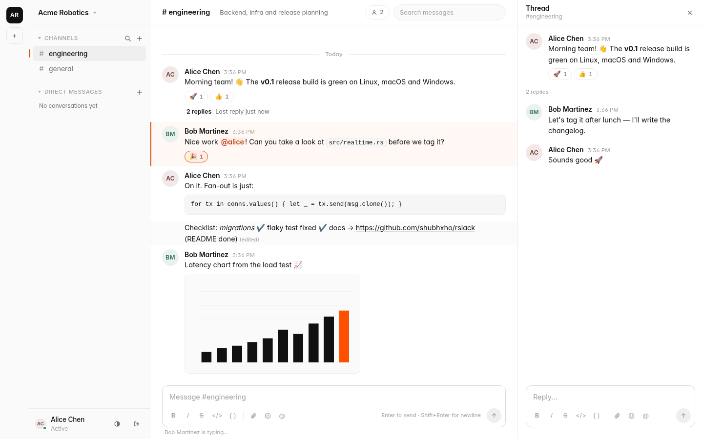
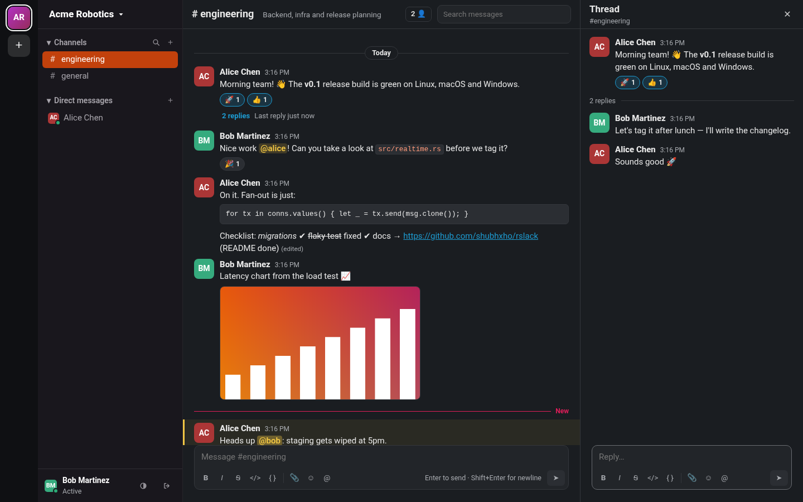
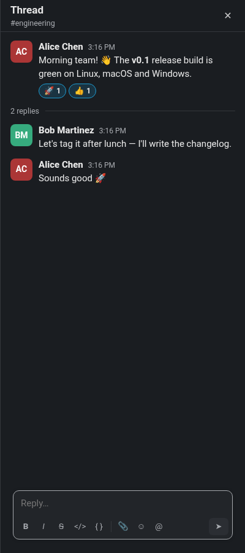
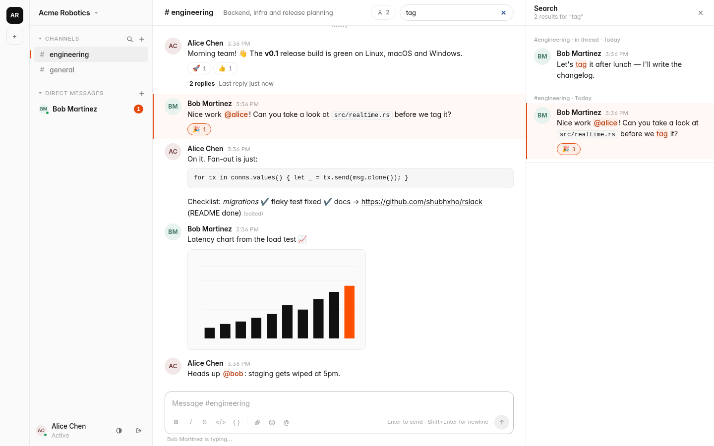
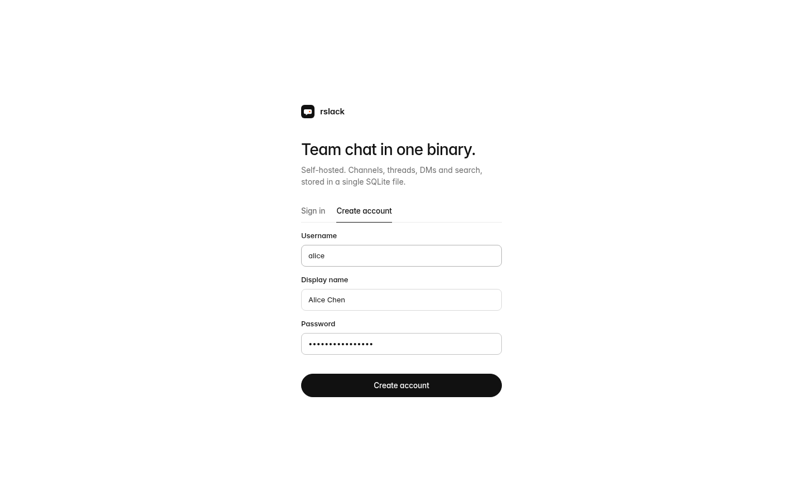
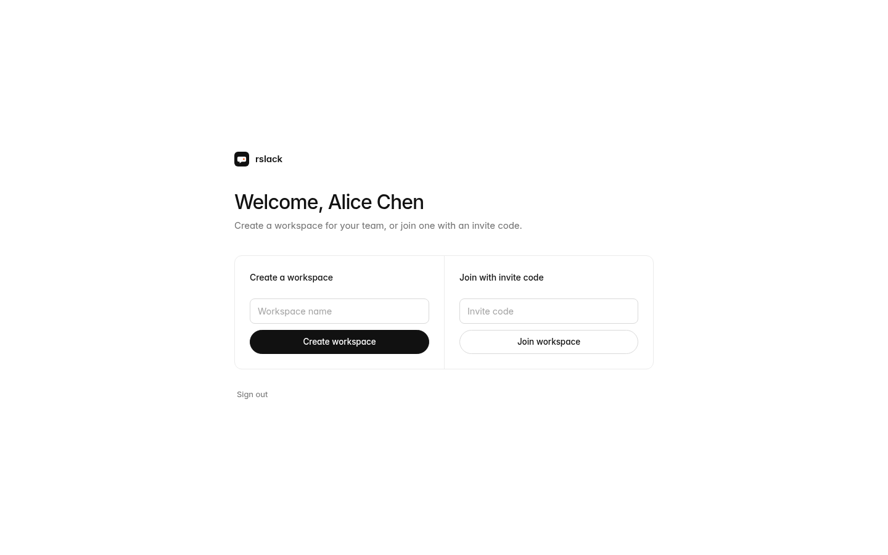
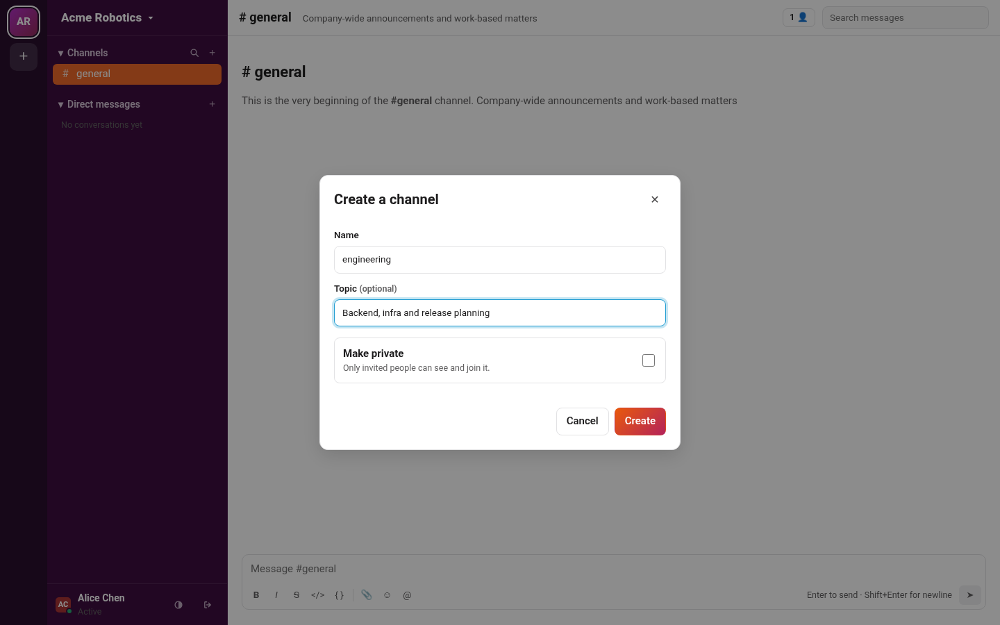
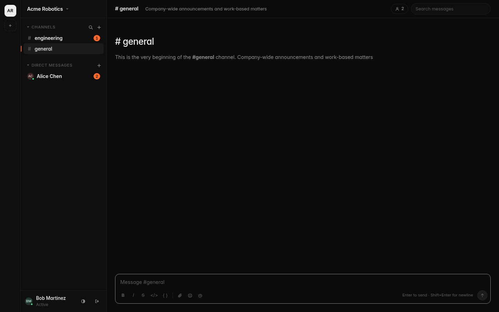
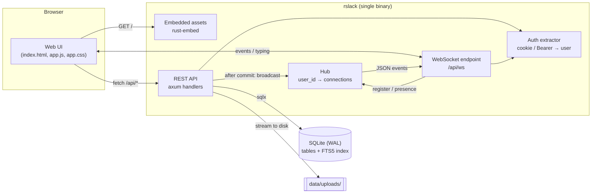
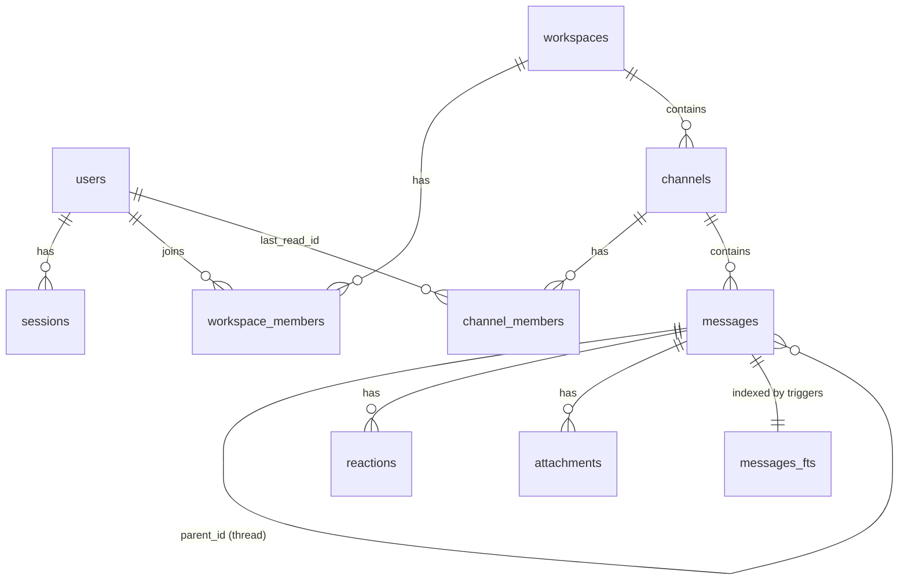

# rslack

A self-hosted, Slack-style team chat in a single Rust binary. The JSON API, the WebSocket and the web UI are all served from one executable, and everything it stores goes in one SQLite file plus an uploads folder. Running it needs nothing else: no Postgres, no Redis, no Node.

**[Website](https://rslack.vercel.app)** · **[PDF guide](docs/rslack-guide.pdf)** (20 pages: architecture, install, configuration, API and WebSocket reference, security model) · **[Release v0.1.0](https://github.com/shubhxho/rslack/releases/tag/v0.1.0)** (Linux x86_64 binary, guide, source)



| Dark theme | Thread panel | Search |
|---|---|---|
|  |  |  |

| Sign up | Onboarding | Create channel | Unread badges |
|---|---|---|---|
|  |  |  |  |

*These screenshots come from a real run: `e2e/e2e.ts` drives two headless-Chrome users against a live server.*

> **Status: v0.1.** It works, and it's tested, but it's young. Read [Limitations](#limitations) before you put it in front of a team.

## Features

- **Accounts**: sign-up and login with **argon2id** password hashing. Session tokens are random (244 bits of entropy), and the database stores only their SHA-256 hash. The token is sent as an `HttpOnly; SameSite=Lax` cookie, and API clients can send it as `Authorization: Bearer` instead. Sessions last 30 days, and logout revokes the session.
- **Workspaces**: create a workspace, or join one with an invite code. Each workspace starts with a `#general` channel, and new members join it automatically.
- **Channels**:
  - Public and private channels: create, browse, join, leave, set a topic, add people.
  - Private channels are invite-only. To non-members they return 404, so their existence isn't revealed.
- **Direct messages**: 1:1 DMs, including a DM with yourself.
- **Realtime over WebSocket**: new, edited and deleted messages, reactions, thread replies, typing indicators, presence (online/offline), and membership changes.
- **Threads**: reply to any top-level message. The parent shows a reply count and when the last reply came in.
- **Reactions**: toggled per user. Hovering shows who reacted. The UI picker offers 32 common emoji, and the API accepts any short emoji string.
- **Edit and delete**: authors only. A deleted message that has replies stays as a placeholder so the thread survives.
- **Unread counts and mention badges** per channel and DM. Every DM message counts as a mention. The tab title shows the total.
- **Full-text search** with SQLite **FTS5**:
  - Prefix matching, with multiple words ANDed together.
  - User input is quoted, so FTS syntax can't be injected.
  - Results only include channels you can read. Edits are re-indexed and deleted messages are dropped.
- **File uploads**:
  - Files are stored on disk under random names, with a configurable size limit (10 MB by default).
  - Images show inline. Anything that isn't a known-safe type is served as an `attachment` with `nosniff` and a sandbox CSP.
  - Only people who can read the channel can download a file.
- **@mentions**: highlighted for everyone, with a stronger highlight when the mention is you. The composer autocompletes names.
- **Web UI**: HTML, CSS and strict TypeScript (`frontend/src/`), compiled to `web/app.js` and embedded with `rust-embed`. The compiled bundle is committed, so `cargo build` never needs Node.
  - Slack-style layout: workspace rail, sidebar, message pane and a thread/search side panel.
  - **Dark and light themes**, which follow your OS setting and can be toggled.
  - Markdown-lite formatting: `*bold*`/`**bold**`, `_italic_`, `~strike~`, `` `code` ``, fenced code blocks, `> quotes`, and auto-linked URLs.
  - Day dividers, a "New" marker at your first unread message, a "load older" button, and editing your last message with ↑.
  - Files can be dragged and dropped or pasted, and the WebSocket reconnects automatically and catches up on missed messages.

## Quickstart

### Prebuilt binary (Linux x86_64)

```sh
curl -LO https://github.com/shubhxho/rslack/releases/download/v0.1.0/rslack-v0.1.0-x86_64-unknown-linux-gnu.tar.gz
curl -LO https://github.com/shubhxho/rslack/releases/download/v0.1.0/rslack-v0.1.0-x86_64-unknown-linux-gnu.tar.gz.sha256
sha256sum -c rslack-v0.1.0-x86_64-unknown-linux-gnu.tar.gz.sha256
tar xzf rslack-v0.1.0-x86_64-unknown-linux-gnu.tar.gz
./rslack-v0.1.0-x86_64-unknown-linux-gnu/rslack   # needs glibc 2.34+
```

### From source

```sh
cargo build --release
./target/release/rslack            # http://127.0.0.1:8080, data in ./data
```

Open http://127.0.0.1:8080, create an account and a workspace, then share the workspace's invite code (in the workspace-name menu → *Invite people*) with your team.

### Docker

```sh
docker compose up -d               # http://localhost:8080, data in the rslack-data volume
```

`Dockerfile` is a two-stage build that ends in a non-root `debian:bookworm-slim` image. Note: the Docker files were written but **not** built during development, because Docker wasn't available on the build machine.

### Configuration

Every option can be set with a CLI flag or an environment variable:

| Flag | Env | Default | Meaning |
|---|---|---|---|
| `--host` | `RSLACK_HOST` | `127.0.0.1` | Bind address (`0.0.0.0` for all interfaces) |
| `-p, --port` | `RSLACK_PORT` | `8080` | TCP port |
| `--data-dir` | `RSLACK_DATA_DIR` | `./data` | Holds `rslack.db` (SQLite, WAL mode) and `uploads/` |
| `--max-upload-mb` | `RSLACK_MAX_UPLOAD_MB` | `10` | Per-file upload limit |
| `--secure-cookies` | `RSLACK_SECURE_COOKIES` | `false` | Add `Secure` to the session cookie. Turn it on behind HTTPS |
| `--allow-signup` | `RSLACK_ALLOW_SIGNUP` | `true` | Set to `false` to close registration |
| `--public-origin` | `RSLACK_PUBLIC_ORIGIN` | *(none)* | Comma-separated public origin(s), e.g. `https://chat.example.com`, accepted for WebSocket `Origin` checks (for proxies that rewrite `Host`) |
| `--cookie-samesite` | `RSLACK_COOKIE_SAMESITE` | `lax` | `lax`, `strict` or `none`. Use `none` (which forces `Secure; Partitioned`) only when the UI is embedded in a cross-site iframe |

Logging uses `RUST_LOG` (default `rslack=info`).

**Reverse proxy:** forward WebSocket upgrades for `/api/ws`. The server rejects WebSocket handshakes whose `Origin` doesn't match the `Host` header, the `X-Forwarded-Host` header, or an entry in `RSLACK_PUBLIC_ORIGIN`, which protects against cross-site WebSocket hijacking. If your proxy rewrites `Host` and doesn't send `X-Forwarded-Host`, set `RSLACK_PUBLIC_ORIGIN`.

**Backups:** stop the server and copy the data directory, or run `sqlite3 data/rslack.db ".backup backup.db"` while it's running and copy `uploads/` as well.

## Architecture



Every write follows the same path: the REST handler checks the user's access, **commits to SQLite**, and then hands a JSON event to the in-process `Hub`. The Hub looks up the audience (the channel's members, or the workspace's members for presence) and pushes the event to every open socket those users have. The WebSocket only carries events from server to client, plus `typing` and `ping` from the client, so every change is persisted before anyone sees it. A client that reconnects simply re-fetches its current view.



The source layout:

- `src/lib.rs`: the router, plus the `start` and `serve` functions.
- `src/auth.rs`: hashing, sessions and the `AuthUser` extractor.
- `src/access.rs`: membership rules.
- `src/workspaces.rs`, `src/channels.rs`, `src/messages.rs`, `src/search.rs`, `src/uploads.rs`: the handlers.
- `src/realtime.rs`: the Hub and the WebSocket.
- `src/web.rs`: the embedded UI.
- `migrations/`: the SQL schema, applied automatically at startup.

## API overview

All endpoints are under `/api` and use JSON. Authenticate with the `rslack_session` cookie that sign-up and login set, or with `Authorization: Bearer <token>`; both of those endpoints also return the token in the response body. Errors look like `{"error": "..."}` and come with a meaningful status code (400, 401, 403, 404, 409 or 413).

| Method & path | What it does |
|---|---|
| `POST /auth/signup` `{username, password, display_name?}` | Create an account and return `{user, token}` |
| `POST /auth/login` `{username, password}` | Log in and return `{user, token}` |
| `POST /auth/logout` | Revoke the current session |
| `GET /me` | The current user |
| `GET /workspaces` · `POST /workspaces {name}` | List your workspaces, or create one |
| `POST /workspaces/join {invite_code}` | Join a workspace |
| `GET /workspaces/:id/members` | Members, with `online` status |
| `GET /workspaces/:id/channels` | Your channels and DMs, with `unread_count`, `mention_count` and `last_read_id` |
| `POST /workspaces/:id/channels {name, topic?, is_private?}` | Create a channel |
| `GET /workspaces/:id/channels/browse` | Public channels, with a `joined` flag |
| `POST /workspaces/:id/dms {user_id}` | Get or create a DM |
| `GET /workspaces/:id/search?q=` | Full-text search |
| `PATCH /channels/:id {topic}` | Set the topic |
| `POST /channels/:id/join` · `/leave` | Join or leave |
| `GET /channels/:id/members` · `POST {user_id \| username}` | List members, or add one (this is how people get into private channels) |
| `GET /channels/:id/messages?before=&limit=` | Top-level messages, oldest first, plus `has_more` |
| `POST /channels/:id/messages {body, parent_id?, attachment_ids?}` | Post a message, or a thread reply when `parent_id` is set |
| `POST /channels/:id/read {message_id}` | Advance your read marker (it never moves backwards) |
| `PATCH /messages/:id {body}` · `DELETE /messages/:id` | Edit or delete (author only) |
| `GET /messages/:id/thread` | `{parent, replies}` |
| `POST /messages/:id/reactions {emoji}` | Toggle a reaction and return `{added, reactions}` |
| `POST /uploads` (multipart field `file`) | Upload a file, then attach it with `attachment_ids` |
| `GET /files/:id` | Download a file (access-checked) |
| `GET /ws` | Open the WebSocket |

**WebSocket events** (server → client): `hello`, `presence`, `message.new`, `message.updated`, `message.deleted`, `reaction.updated`, `typing`, `channel.updated`, `channel.read`, `channels.changed`, `channel.members_changed`, `workspace.member_joined`, `workspaces.changed`, `pong`.
**Client → server:** `{"type":"typing","channel_id":1,"parent_id":null}` and `{"type":"ping"}`.

Example:

```sh
TOKEN=$(curl -s localhost:8080/api/auth/signup -H 'content-type: application/json' \
  -d '{"username":"ci-bot","password":"a-long-password"}' | jq -r .token)
curl -s localhost:8080/api/workspaces -H "authorization: Bearer $TOKEN"
```

## Development

```sh
cargo fmt --all -- --check
cargo clippy --all-targets -- -D warnings
cargo test        # unit tests + HTTP/WebSocket integration tests against a real server
```

The integration tests in `tests/` start the real server on an ephemeral port with a temporary data directory. They cover:

- Auth.
- Workspaces and invites.
- Public and private channels, and DMs.
- Messaging: posting, pagination, editing and deleting.
- Threads, reactions, and unread and mention counts.
- Search, including access control and injection-safe queries.
- Uploads: access, the size limit and safe content types.
- WebSocket: two clients receiving each other's broadcasts, typing, presence, private-channel isolation, and auth/Origin checks.

The browser walkthrough runs against a live server:

```sh
RSLACK_DATA_DIR=$(mktemp -d) RSLACK_PORT=8099 ./target/release/rslack &
npm ci && CHROME=/path/to/chrome npm run e2e   # also rewrites docs/screenshots/
```

### Frontend (TypeScript)

The web client lives in `frontend/src/` (`app.ts`, `dom.ts`, and `types.ts`, which mirrors the Rust API and WebSocket types). It is compiled with esbuild into `web/app.js`, which is committed, so Rust-only contributors never need Node. Node 22.18+ (or 24) is needed only for frontend work:

```sh
npm ci
npm run typecheck    # strict tsc for the web client and the e2e/diagram scripts
npm run build:web    # frontend/src/*.ts → web/app.js
npm run check:web    # fails if web/app.js is stale
```

Debug builds read `web/` from disk, so run `npm run build:web` and reload the page.

### Docs

```sh
npm run diagrams              # docs/diagrams/*.mmd → *.svg (needs Chrome)
python3 docs/build_guide.py   # docs/rslack-guide.pdf (needs Chrome)
```

CI (`.github/workflows/ci.yml`) runs fmt, clippy, the tests and a release build on Linux, macOS and Windows, plus a `cargo check` on the MSRV, **Rust 1.88**, and a frontend job that runs the typecheck and checks that `web/app.js` is up to date.

## Limitations

These are known gaps in v0.1, listed so they aren't a surprise:

- **Single node only.** The realtime Hub lives in memory, so you can't run several replicas behind a load balancer. SQLite also means a single writer, which is fine for small and medium teams but untested at large scale; there are no load tests yet.
- **No roles or moderation.** There's no admin UI, no kicking or banning, and no deleting channels or workspaces. Workspace owners are recorded but have no extra powers yet. Anyone with the invite code can join, and codes can't be rotated or expired yet.
- **No rate limiting** on login or on the API. Put the server behind a proxy that limits requests if it faces the internet.
- **No email, password reset or 2FA.** Changing a password or display name isn't in the UI or the API yet.
- **Unread and mention counts only cover top-level messages.** Thread replies don't increase the channel's unread badge, and there's no "Threads" inbox. Mention detection is a substring match on `@username`, so `@bob` also matches inside `@bobby`.
- **DMs are 1:1 only**; there are no group DMs.
- **Search** is word-prefix FTS5 with no filters (such as `from:` or `in:`), and it returns at most 50 results.
- **Uploads**:
  - Files that were uploaded but never attached to a message aren't cleaned up.
  - Deleting a message hides its attachments but doesn't delete the files.
  - There are no image thumbnails.
- **No push or desktop notifications**, and no unfurling of link previews.
- **The UI was tested in headless Chrome only.** The layout shrinks for narrow windows but isn't a proper mobile design. Accessibility hasn't been audited.
- Presence is per connection: you're "online" while any tab has an open socket. There's no away or idle state.
- The Docker image hasn't been built yet (see Quickstart).

## License

MIT © 2026 shubhxho. See [LICENSE](LICENSE).

The UI embeds a Latin subset of the [Inter](https://github.com/rsms/inter) typeface (`web/fonts/Inter.woff2`), licensed under the SIL Open Font License 1.1; see `web/fonts/LICENSE-Inter.txt`.
